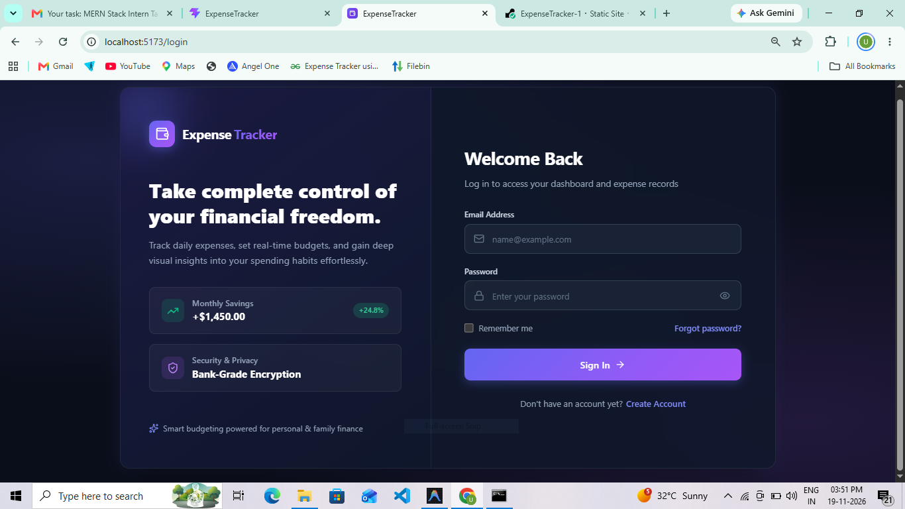
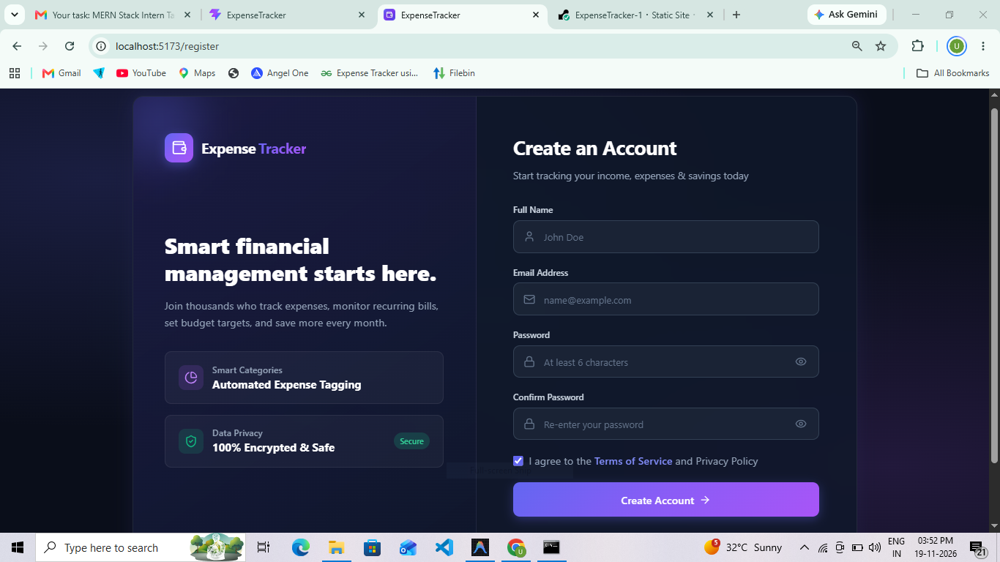
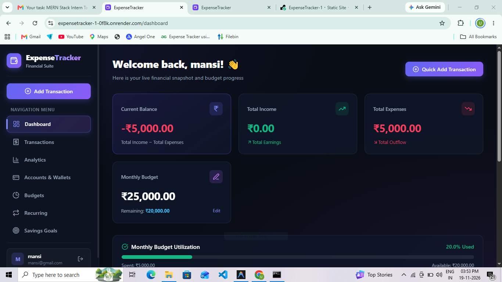
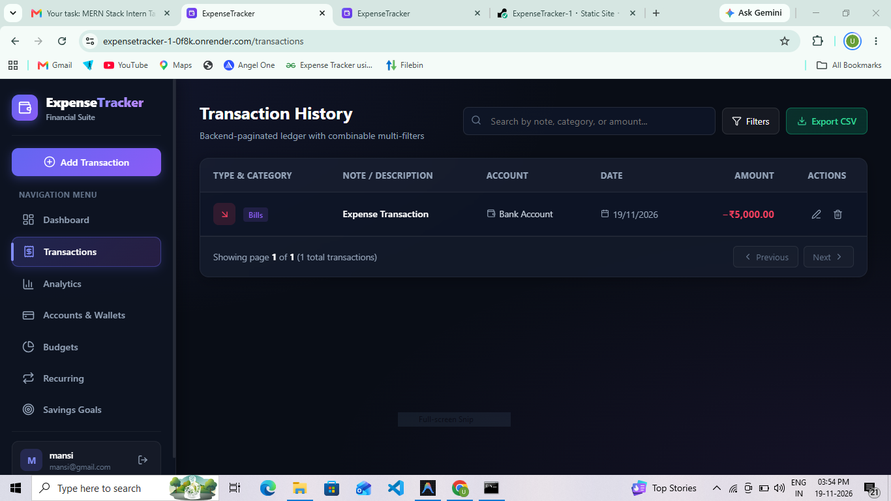
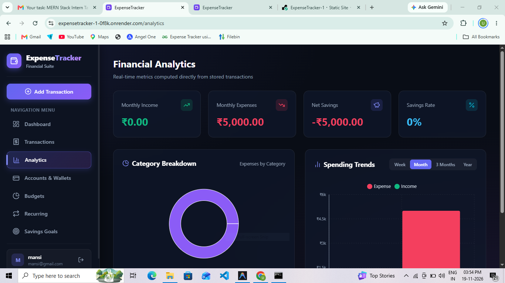
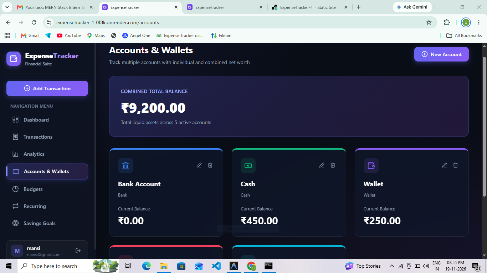
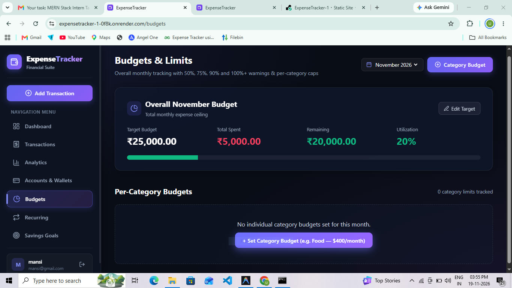
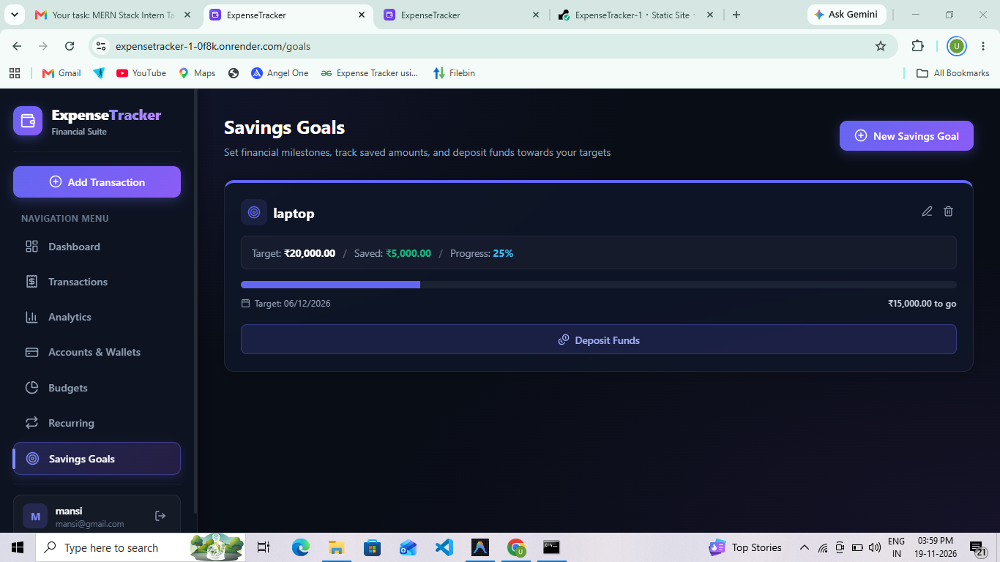
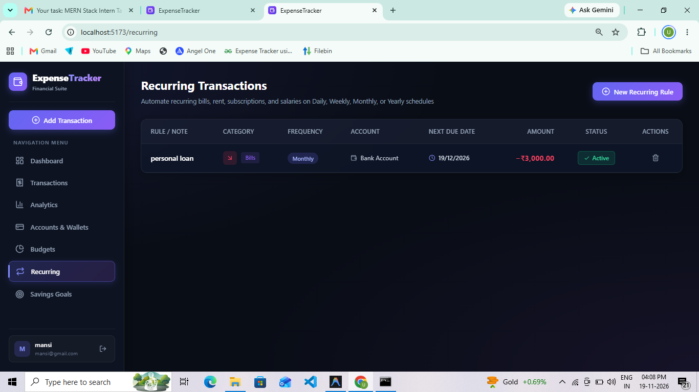
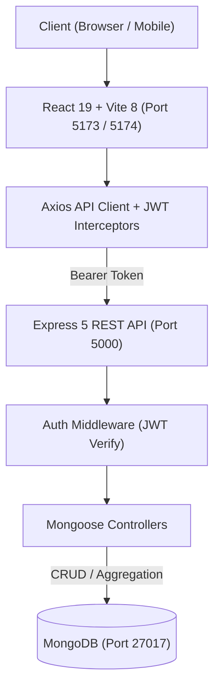

# 💰 Expense Tracker — Full-Stack MERN Application

A modern, responsive, and feature-complete personal finance management application built with the **MERN** stack (**MongoDB, Express.js, React 19, Node.js**) and **Vite**. 

Designed with an intuitive dark-themed UI, fixed sticky sidebar navigation, real-time analytics, automated recurring transactions, savings milestones, multi-account ledger, and instant **CSV data export**.

---

## 📌 Table of Contents
- [Project Overview](#-project-overview)
- [Video Demo & Walkthrough](#-video-demo--walkthrough)
- [Application Screenshots](#-application-screenshots)
- [Key Features](#-key-features)
- [Architecture & Tech Stack](#-architecture--tech-stack)
- [Project Directory Structure](#-project-directory-structure)
- [API Endpoint Reference](#-api-endpoint-reference)
- [Environment Variables](#-environment-variables)
- [Setup & Installation](#-setup--installation)
- [Testing Instructions](#-testing-instructions)
- [Known Limitations & Future Scope](#-known-limitations--future-scope)

---

## 🌟 Project Overview

Managing personal finances shouldn't be cumbersome or scattered across spreadsheets. **Expense Tracker** provides a centralized, secure dashboard to track daily inflows and outflows, manage multiple accounts and digital wallets, maintain strict monthly and category-level budgets, automate recurring subscriptions, and visualize wealth growth with interactive charts.

- **Currency Standard**: Built natively with Indian Rupee (`₹` / INR) formatting (`en-IN`) across all cards, graphs, and input modals.
- **Responsive Design**: Custom responsive layouts optimized for desktop monitors, 768px laptop viewports, tablets, and Android mobile devices without vertical clipping or overflow issues.
- **Real-Time Computations**: All charts, balances, and budget progress indicators are computed dynamically from stored database transactions.

---

## 🎬 Video Demo & Walkthrough

Watch the complete interactive video demonstration covering user authentication, multi-wallet ledger, transaction filtering, CSV export, monthly/category budgets, and recurring rules:

[](https://youtu.be/oA9MdINWKZ0)

> ▶️ **Watch on YouTube**: [ExpenseTracker Full Demo Walkthrough (Live Video)](https://youtu.be/oA9MdINWKZ0)

---

## 📸 Application Screenshots

### 1. User Authentication (Login & Registration)
| Sign In Page (`/login`) | Registration Page (`/register`) |
|:---:|:---:|
|  |  |

---

### 2. Financial Dashboard
> *Live KPI metric cards (Current Balance, Total Income, Total Expenses), monthly budget utilization progress bar, historical spending trends chart, and recent ledger entries.*


---

### 3. Transaction History & Filterable Ledger
> *Server-side paginated ledger with real-time combinable filters (Type, Category, Account, Date Range, Amount Range), live search, and one-click CSV export.*


---

### 4. Financial Analytics & Visual Trends
> *Category-wise donut breakdown chart and switchable spending trends (Week | Month | 3 Months | Year) computed from real database records.*


---

### 5. Multi-Account & Digital Wallet Ledger
> *Manage Bank Accounts, Cash, Digital Wallets, and Credit Cards with individual balances and combined liquid net worth.*


---

### 6. Monthly & Category-Level Budgets
> *Overall monthly spending ceilings with tiered warnings at 50%, 75%, 90%, and 100%+ along with independent category limits.*


---

### 7. Savings Goals & Milestone Tracking
> *Set financial targets, deadlines, monitor saved amounts and progress percentage, and deposit funds towards milestones.*


---

### 8. Automated Recurring Transactions (Table View)
> *Structured table view for Daily, Weekly, Monthly, and Yearly recurring bills, subscriptions, and salaries with Active/Paused toggles.*


---

## ✨ Key Features

### 1. 🔐 Authentication & Session Security
- User registration and login powered by **JWT (JSON Web Tokens)** and **bcryptjs** password hashing.
- Route guards (`ProtectedRoute` and `PublicRoute`) preventing unauthorized ledger access.
- Live client-side password strength meter and form validation.

### 2. 📊 Dynamic Financial Dashboard
- **Live KPI Metrics**:
  - **Current Balance**: $\text{Total Balance} = \text{Total Income} - \text{Total Expenses}$
  - **Total Income** & **Total Expenses**
  - **Monthly Target Budget**, **Remaining Budget**, and **% Budget Used**.
- **Interactive Visualizations**: 6-month historical income vs. expense bar charts powered by **Recharts**.
- **Recent Transactions Ledger**: Displays the 5–10 most recent transactions with quick-delete and quick-add actions.

### 3. 💳 Transactions Management (Add / Edit / Delete)
- **Form Attributes**: Amount, Type (`income` / `expense`), Category, Account/Wallet, Note, Date (defaults to today), optional attachments, and recurring toggle.
- **Default & Custom Categories**:
  - *Expense*: Food, Travel, Shopping, Bills, Rent, Entertainment, Health, Education, Subscription, Other.
  - *Income*: Salary, Freelance, Business, Investment, Gift, Other.
  - Users can create custom categories on-the-fly directly inside the transaction modal.

### 4. 📜 Transaction History & Backend Pagination
- **Server-Side Pagination**: Efficient `skip` / `limit` queries without holding the full database collection in memory.
- **Combinable Filters**: Filter by Type, Category, Account, Date Range, and Amount Range simultaneously.
- **Live Search**: Instant multi-field text search across notes, descriptions, categories, and numerical amounts.

### 5. 📥 CSV Export (Filtered & Raw)
- One-click **Export CSV** button in the ledger toolbar and filter drawer.
- Respects **active filters**: only exports matching records when filters are applied.
- Conforms strictly to CSV specifications:
  ```csv
  Date,Type,Category,Account,Amount,Note
  2026-07-01,Expense,Food,Cash,25,Lunch
  2026-07-02,Income,Salary,Bank Account,2500,Monthly Salary
  ```
- Handles quotation and comma escaping automatically.

### 6. 📈 Financial Analytics & Trends
- Real-time monthly aggregations for total income, expenses, net savings, and savings rate.
- **Category-Wise Breakdown**: Interactive donut chart detailing expense distribution.
- **Spending Trends Over Time**: Switchable time horizons: **Week | Month | 3 Months | Year**.

### 7. 🏦 Accounts & Wallets Management
- Supports multiple financial accounts: **Cash**, **Bank Account**, **Credit Card**, **Digital Wallet**, and **Savings**.
- Every transaction is linked to an account; account balances auto-increment on income and decrement on expenses.
- Aggregated net worth summary card displaying combined balances.

### 8. 🎯 Monthly & Per-Category Budgets
- Set overall monthly budgets with automatic utilization progress indicators.
- **Tiered Warning Alerts**:
  - 🟡 **50% Warning**: "You have reached 50% of your budget."
  - 🟠 **75% Warning**: "You have reached 75% of your budget."
  - 🔶 **90% Warning**: "You have used 90% of your [Month] budget."
  - 🔴 **100%+ Critical Warning**: "Budget exceeded by ₹[Amount]."
- **Category Budgets**: Track independent budgets (e.g. *Food — ₹15,000/month*) with dedicated progress bars.

### 9. 🔁 Automated Recurring Transactions
- Automate repeating inflows and outflows: Rent, Salary, Netflix, SIPs, EMIs.
- Recurrence frequencies: **Daily**, **Weekly**, **Monthly**, **Yearly**.
- The backend automatically executes and records new transactions when the scheduled `nextDueDate` arrives.

### 10. 🎯 Savings Goals & Milestones
- Track long-term financial targets (e.g., *Emergency Fund, New Laptop, Vacation*).
- Displays target amount, currently saved, target completion date, and live percentage progress.
- Quick **Deposit Funds** action with optional deduction from a linked bank or cash account.

---

## 🏗 Architecture & Tech Stack



### Technology Breakdown
- **Frontend**:
  - **React 19** (`react`, `react-dom`)
  - **Vite 8** (lightning-fast HMR and production bundle optimization)
  - **React Router DOM v7** (declarative client-side routing & auth guards)
  - **Recharts** (responsive SVG charts: Bar charts, Donut charts)
  - **Lucide React** (modern iconography: `IndianRupee`, `Filter`, `Download`, etc.)
- **Backend**:
  - **Node.js** (v18+) & **Express.js 5**
  - **MongoDB** with **Mongoose 9** (Object Data Modeling)
  - **JSONWebToken (JWT)** & **bcryptjs** (Stateless authentication & password encryption)
  - **CORS** & **dotenv** (Cross-origin support & configuration)

---

## 📂 Project Directory Structure

```text
Expensetracker/
├── backend/
│   ├── config/
│   │   └── db.js                 # MongoDB connection logic
│   ├── controllers/
│   │   ├── accountController.js   # Multi-account CRUD & balance adjustments
│   │   ├── analyticsController.js # MongoDB aggregation for charts & trends
│   │   ├── authController.js      # User registration, login, profile
│   │   ├── budgetController.js    # Overall & category budget progress/warnings
│   │   ├── categoryController.js  # Category seeding & custom categories
│   │   ├── goalController.js      # Savings targets & milestone deposits
│   │   ├── recurringController.js # Recurring schedules & auto-generation
│   │   └── transactionController.js # Ledger queries, pagination & CSV export
│   ├── middleware/
│   │   ├── authMiddleware.js      # JWT authentication protector
│   │   └── errorMiddleware.js     # Standardized JSON error response handler
│   ├── models/
│   │   ├── Account.js
│   │   ├── Budget.js
│   │   ├── Category.js
│   │   ├── RecurringTransaction.js
│   │   ├── SavingsGoal.js
│   │   ├── Transaction.js
│   │   └── User.js
│   ├── routes/                    # Express route declarations
│   ├── .env                       # Backend environment variables
│   ├── app.js                     # Express middleware & route mounting
│   ├── package.json
│   └── server.js                  # HTTP server listener
│
├── frontend/
│   ├── public/
│   ├── src/
│   │   ├── api/                   # Modular Axios API endpoints
│   │   ├── components/
│   │   │   ├── AddTransactionModal.jsx
│   │   │   ├── AppLayout.jsx      # Sticky fixed sidebar + scrollable body
│   │   │   ├── EditTransactionModal.jsx
│   │   │   └── RouteGuards.jsx    # ProtectedRoute & PublicRoute
│   │   ├── context/
│   │   │   ├── AuthContext.jsx    # AuthProvider & auth state
│   │   │   └── useAuth.js         # Custom authentication hook
│   │   ├── pages/
│   │   │   ├── AccountsPage.jsx   # Accounts & digital wallets
│   │   │   ├── AnalyticsPage.jsx  # Trends, donut charts & KPIs
│   │   │   ├── BudgetsPage.jsx    # Monthly & category budgets
│   │   │   ├── Dashboard.jsx      # Main executive dashboard
│   │   │   ├── GoalsPage.jsx      # Savings goals & deposits
│   │   │   ├── Login.jsx          # Login view with demo credentials
│   │   │   ├── Register.jsx       # Registration view with meter
│   │   │   ├── RecurringPage.jsx  # Recurring transaction rules
│   │   │   └── TransactionsPage.jsx # Paginated ledger + CSV export
│   │   ├── utils/
│   │   │   ├── exportCSV.js       # CSV formatting & browser download utility
│   │   │   └── formatCurrency.js  # Indian Rupee (₹ / INR) formatting
│   │   ├── App.jsx                # Application routes
│   │   ├── main.jsx               # React DOM entry point
│   │   └── index.css              # Global styles & dark design tokens
│   ├── package.json
│   └── vite.config.js
├── img/                               # Application UI screenshots & demo assets
│   ├── image1.PNG                     # Sign In screen
│   ├── image2.PNG                     # Registration screen
│   ├── image3.PNG                     # Financial Dashboard
│   ├── image4.PNG                     # Transactions ledger & CSV export
│   ├── image5.PNG                     # Financial analytics & charts
│   ├── image6.PNG                     # Accounts & multi-wallet ledger
│   ├── image7.PNG                     # Monthly & category budgets
│   ├── image8.PNG                     # Savings goals milestones
│   └── image9.PNG                     # Recurring transactions table
└── README.md
```

---

## 📡 API Endpoint Reference

All protected endpoints require an `Authorization: Bearer <token>` header.

### 1. Authentication (`/api/auth`)
| Method | Path | Purpose | Auth Required | Request Body / Params |
| :--- | :--- | :--- | :---: | :--- |
| `POST` | `/api/auth/register` | Register a new user | No | `{ name, email, password }` |
| `POST` | `/api/auth/login` | Login user & issue JWT | No | `{ email, password }` |
| `GET` | `/api/auth/me` | Fetch authenticated user profile | **Yes** | None |

### 2. Transactions & Ledger (`/api/transactions`)
| Method | Path | Purpose | Auth Required | Request Body / Params |
| :--- | :--- | :--- | :---: | :--- |
| `GET` | `/api/transactions` | Paginated transactions with multi-filters | **Yes** | `?page=1&limit=10&type=&category=&account=&startDate=&endDate=&minAmount=&maxAmount=&search=` |
| `POST` | `/api/transactions` | Create a new transaction | **Yes** | `{ amount, type, category, account, note, date, attachment, isRecurring, frequency }` |
| `GET` | `/api/transactions/export/csv` | **Export ledger as CSV** with active filters | **Yes** | Filter query parameters (same as `GET /api/transactions`) |
| `GET` | `/api/transactions/:id` | Get transaction details by ID | **Yes** | Path parameter `:id` |
| `PUT` | `/api/transactions/:id` | Update an existing transaction | **Yes** | `{ amount, type, category, account, note, date }` |
| `DELETE` | `/api/transactions/:id` | Delete transaction & auto-revert account balance | **Yes** | Path parameter `:id` |

### 3. Categories (`/api/categories`)
| Method | Path | Purpose | Auth Required | Request Body / Params |
| :--- | :--- | :--- | :---: | :--- |
| `GET` | `/api/categories` | Get default & user custom categories | **Yes** | `?type=expense` or `?type=income` |
| `POST` | `/api/categories` | Create custom category | **Yes** | `{ name, type, icon, color }` |
| `PUT` | `/api/categories/:id` | Edit custom category | **Yes** | `{ name, icon, color }` |
| `DELETE` | `/api/categories/:id` | Delete custom category | **Yes** | Path parameter `:id` |

### 4. Accounts & Wallets (`/api/accounts`)
| Method | Path | Purpose | Auth Required | Request Body / Params |
| :--- | :--- | :--- | :---: | :--- |
| `GET` | `/api/accounts` | Get all accounts & combined total balance | **Yes** | None |
| `POST` | `/api/accounts` | Create bank/wallet account | **Yes** | `{ name, type, balance, color }` |
| `GET` | `/api/accounts/:id` | Get account details | **Yes** | Path parameter `:id` |
| `PUT` | `/api/accounts/:id` | Update account | **Yes** | `{ name, type, balance, color }` |
| `DELETE` | `/api/accounts/:id` | Delete account | **Yes** | Path parameter `:id` |

### 5. Budgets (`/api/budgets`)
| Method | Path | Purpose | Auth Required | Request Body / Params |
| :--- | :--- | :--- | :---: | :--- |
| `GET` | `/api/budgets` | Get overall & category budgets with live spent % | **Yes** | `?month=11&year=2026` |
| `POST` | `/api/budgets` | Set or update monthly budget | **Yes** | `{ isOverall, category, amount, month, year }` |
| `DELETE` | `/api/budgets/:id` | Delete budget allocation | **Yes** | Path parameter `:id` |

### 6. Analytics (`/api/analytics`)
| Method | Path | Purpose | Auth Required | Request Body / Params |
| :--- | :--- | :--- | :---: | :--- |
| `GET` | `/api/analytics/summary` | Current month income, expenses & net savings | **Yes** | None |
| `GET` | `/api/analytics/category-breakdown` | Category-wise expense distribution for donut chart | **Yes** | `?type=expense&startDate=&endDate=` |
| `GET` | `/api/analytics/trends` | Historical trend data for bar/line charts | **Yes** | `?period=week` / `month` / `3months` / `year` |

### 7. Recurring Transactions (`/api/recurring`)
| Method | Path | Purpose | Auth Required | Request Body / Params |
| :--- | :--- | :--- | :---: | :--- |
| `GET` | `/api/recurring` | Get all recurring rules (auto-processes due) | **Yes** | None |
| `POST` | `/api/recurring` | Create automated recurring schedule | **Yes** | `{ description, type, amount, frequency, category, account, nextDueDate }` |
| `PUT` | `/api/recurring/:id` | Toggle active/paused or update rule | **Yes** | `{ isActive, amount, frequency }` |
| `DELETE` | `/api/recurring/:id` | Delete recurring rule | **Yes** | Path parameter `:id` |

### 8. Savings Goals (`/api/goals`)
| Method | Path | Purpose | Auth Required | Request Body / Params |
| :--- | :--- | :--- | :---: | :--- |
| `GET` | `/api/goals` | List all savings milestones & completion % | **Yes** | None |
| `POST` | `/api/goals` | Create savings goal target | **Yes** | `{ name, targetAmount, currentAmount, targetDate, color }` |
| `PUT` | `/api/goals/:id` | Edit goal or deposit funds | **Yes** | `{ name, targetAmount, depositAmount, accountId }` |
| `DELETE` | `/api/goals/:id` | Delete savings goal | **Yes** | Path parameter `:id` |

---

## ⚙️ Environment Variables

Create a `.env` file in the `backend/` folder with the following variables:

```ini
# Backend Server Port
PORT=5000

# Execution Environment (development | production)
NODE_ENV=development

# MongoDB Connection String
MONGO_URI=mongodb://localhost:27017/expense_tracker

# JWT Authentication Secret & Lifespan
JWT_SECRET=super_secret_jwt_key_2026_expense_tracker
JWT_EXPIRE=30d
```

---

## 🚀 Setup & Installation

### Prerequisites
- **Node.js**: `v18.0.0` or higher
- **MongoDB**: Local MongoDB community server running on port `27017` (or MongoDB Atlas URI)
- **npm** or **yarn**

### 1. Clone & Navigate
```bash
git clone https://github.com/your-username/expense-tracker.git
cd expense-tracker
```

### 2. Backend Setup
```bash
cd backend

# Install dependencies
npm install

# Start the backend server (runs on http://localhost:5000)
npm run dev
# or: npm start
```

### 3. Frontend Setup
Open a second terminal window:
```bash
cd frontend

# Install frontend dependencies
npm install

# Start the Vite development server
npm run dev
```

Open your browser and navigate to:
```
http://localhost:5173/
```
*(If port 5173 is in use, Vite will automatically serve on http://localhost:5174/)*.

---

## 🧪 Testing Instructions

### 1. Frontend Code Quality & Build Checks
From the `frontend/` directory:
```bash
# Run ESLint validation
npm run lint

# Verify clean production bundle build
npm run build
```

### 2. Backend API Health Check
```bash
curl http://localhost:5000/api/health
# Response: {"status":"ok","timestamp":"..."}
```

### 3. Test CSV Export via cURL
```bash
# 1. Login to retrieve token
curl -X POST http://localhost:5000/api/auth/login \
  -H "Content-Type: application/json" \
  -d '{"email":"aman@gmail.com","password":"password123"}'

# 2. Export filtered transactions as CSV
curl -X GET "http://localhost:5000/api/transactions/export/csv?type=expense" \
  -H "Authorization: Bearer <YOUR_JWT_TOKEN>" \
  --output test_expenses.csv
```

---

## ⚠️ Known Limitations & Future Scope

1. **Local Storage Image Attachments**:
   - Currently, receipt attachments are stored as local URLs or metadata strings. Production environments should integrate **AWS S3** or **Cloudinary** for image uploads.
2. **Recurring Schedule Worker**:
   - Recurring rules are evaluated on user access/login. For non-active users, adding a standing background scheduler (e.g. `node-cron` daemon or **BullMQ** with Redis) will ensure automated processing regardless of user activity.
3. **Multi-Currency Support**:
   - The application is optimized for Indian Rupee (`₹`). A future enhancement can allow users to toggle their preferred base currency (USD, EUR, GBP) in user settings.

---

## 📄 License
This project is licensed under the [ISC License](LICENSE).
